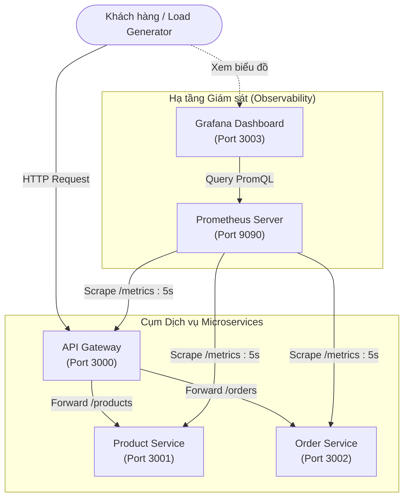

# 🚀 HNT Microservices Monitoring & Observability System
> **Đề tài Seminar:** Kiến Trúc Hướng Dịch Vụ (Service-Oriented Architecture - SOA)  
> **Chủ đề:** Giám sát (Monitoring) & Đo đạc hiệu năng (Observability) hệ thống Microservices với **Prometheus** và **Grafana**

---

## 📌 1. Tổng quan dự án

Dự án mô phỏng một hệ thống thương mại điện tử đơn giản được xây dựng theo kiến trúc **Microservices / SOA**, tích hợp giải pháp giám sát toàn diện (**End-to-End Monitoring & Observability**):
- **API Gateway**: Đóng vai trò Reverse Proxy & Single Entry Point, tiếp nhận toàn bộ request từ người dùng và điều phối đến các dịch vụ nội bộ.
- **Product Service**: Quản lý danh mục và thông tin sản phẩm.
- **Order Service**: Xử lý tạo và quản lý đơn hàng (theo dõi cả Technical Metrics và Business Metrics).
- **Prometheus**: Thu thập và lưu trữ số liệu Time-Series Metrics định kỳ (Pull Model) với tần suất `5s/lần`.
- **Grafana**: Trực quan hóa dữ liệu hiệu năng hệ thống, tỷ lệ lỗi, độ trễ và số liệu nghiệp vụ theo thời gian thực thông qua Dashboard được cấu hình tự động (**Auto-provisioning**).
- **Load Generator Tool**: Công cụ sinh tải thực tế với nhiều kịch bản (Normal, Heavy, Spike, Errors) phục vụ trình diễn và kiểm thử.

---

## 🏗️ 2. Sơ đồ kiến trúc hệ thống



---

## 🌐 3. Danh mục Dịch vụ & Cổng truy cập

| Dịch vụ | Container Name | Cổng (Host) | Cổng nội bộ | Đường dẫn chính | Chức năng |
| :--- | :--- | :---: | :---: | :--- | :--- |
| **API Gateway** | `hnt-api-gateway` | `3000` | `3000` | `http://localhost:3000` | Reverse Proxy, chuyển hướng và tổng hợp metrics |
| **Product Service** | `hnt-product-service` | `3001` | `3001` | `http://localhost:3001` | Quản lý sản phẩm |
| **Order Service** | `hnt-order-service` | `3002` | `3002` | `http://localhost:3002` | Đặt hàng & đo lường nghiệp vụ |
| **Prometheus** | `hnt-prometheus` | `9090` | `9090` | `http://localhost:9090` | Thu thập & truy vấn Time-Series Metrics |
| **Grafana** | `hnt-grafana` | `3003` | `3000` | `http://localhost:3003` | Trực quan hóa Dashboard (Admin: `admin/admin`) |

> 💡 **Mẹo**: Khi truy cập trực tiếp `http://localhost:3000` hoặc `http://localhost:3000/dashboard` từ trình duyệt, API Gateway sẽ tự động redirect tới Grafana Dashboard (`http://localhost:3003`).

---

## 📊 4. Các chỉ số đo đạc (Metrics & Monitoring Model)

Dự án áp dụng mô hình chuẩn công nghiệp **RED Method** (Rate, Errors, Duration) kết hợp với **Business Metrics**:

### 4.1. Technical Metrics (Kỹ thuật hệ thống)
1. **Request Rate (Tần suất yêu cầu)**:
   - Metric: `http_requests_total` (Counter)
   - PromQL: `sum by (job) (rate(http_requests_total[1m]))`
2. **Error Rate (Tỷ lệ lỗi)**:
   - Metric: `http_requests_total{status=~"5.."}` & `{status=~"4.."}`
   - PromQL 5xx: `(sum by (job) (rate(http_requests_total{status=~"5.."}[1m])) / sum by (job) (rate(http_requests_total[1m]))) * 100`
3. **Latency / Duration (Độ trễ xử lý)**:
   - Metric: `http_response_time_seconds_bucket` (Histogram, buckets từ 5ms đến 5s)
   - PromQL p95: `histogram_quantile(0.95, sum by (job, le) (rate(http_response_time_seconds_bucket[1m])))`
4. **Availability (Tính khả dụng của dịch vụ)**:
   - Metric: `up{job=~"api-gateway|product-service|order-service"}` (1: UP, 0: DOWN)

### 4.2. Business Metrics (Số liệu nghiệp vụ)
1. **Total Orders Created (Tổng số đơn hàng được tạo)**:
   - Metric: `orders_created_total{status="success|failed"}` (Counter)
   - Giúp đánh giá số lượng giao dịch thành công / thất bại.
2. **Active Orders Processing (Đơn hàng đang xử lý nền)**:
   - Metric: `orders_processing_active` (Gauge)
   - Mô phỏng tác vụ ngầm: tăng lên khi nhận đơn và tự giảm sau 3 giây xử lý.
3. **Order Creation Rate (Tốc độ đặt hàng)**:
   - PromQL: `sum by (status) (rate(orders_created_total[1m]) * 60)` (đơn/phút).

---

## 🖥️ 5. Chi tiết Grafana Dashboard

Grafana được cấu hình **Provisioning tự động** (không cần import thủ công) với dashboard: **`HNT Microservices Overview`**:

| STT | Panel Title | Loại hiển thị | Ý nghĩa và mục tiêu giám sát |
| :-: | :--- | :---: | :--- |
| **1** | **Service Availability** | Stat Panel | Trạng thái sống/chết (Healthcheck) của từng service (Xanh = UP, Đỏ = DOWN). |
| **2** | **Total HTTP Requests** | Stat Panel | Tổng lưu lượng request toàn bộ hệ thống kể từ khi khởi động. |
| **3** | **Business: Total Orders Created** | Stat Panel | Tổng số đơn hàng đặt thành công (`orders_created_total{status="success"}`). |
| **4** | **Business: Active Orders Processing** | Stat Panel (Gauge) | Số lượng đơn hàng đang được xử lý đồng thời trong hàng đợi. |
| **5** | **Request Rate (req/s)** | Time Series | Biểu đồ biến thiên lưu lượng request trên từng microservice theo thời gian. |
| **6** | **HTTP 5xx Error Rate (%)** | Time Series | Tỷ lệ phần trăm lỗi máy chủ (cảnh báo ngưỡng Vàng > 1%, Đỏ > 5%). |
| **7** | **Request Latency: p95 (seconds)** | Time Series | 95% số request hoàn thành trong thời gian bao lâu (phát hiện nghẽn cổ chai). |
| **8** | **HTTP Error Distribution** | Time Series | Chi tiết phân phối mã lỗi `4xx` (Client error) và `5xx` (Server error). |
| **9** | **Order Creation Rate** | Time Series | Biểu đồ tốc độ tạo đơn hàng (orders/minute) theo thời gian thực. |

---

## ⚡ 6. Hướng dẫn khởi chạy

### Cách 1: Khởi chạy bằng Docker Compose (Khuyên dùng)
Yêu cầu: Đã cài đặt **Docker Desktop**.

1. **Khởi động toàn bộ cụm dịch vụ:**
   ```bash
   docker compose up -d --build
   ```

2. **Kiểm tra trạng thái các container:**
   ```bash
   docker compose ps
   ```

3. **Dừng hệ thống:**
   ```bash
   docker compose down
   ```

---

### Cách 2: Khởi chạy nội bộ bằng Node.js (Local Run)
Yêu cầu: Node.js (phiên bản 18+).

1. **Cài đặt thư viện cho các service:**
   ```bash
   cd api-gateway && npm install && cd ..
   cd product-service && npm install && cd ..
   cd order-service && npm install && cd ..
   ```

2. **Chạy kịch bản khởi động tự động trên Windows:**
   - Click đúp vào file `start-services-local.bat` hoặc gõ:
     ```cmd
     start-services-local.bat
     ```
   *(Kịch bản sẽ tự động mở 3 cửa sổ cmd cho API Gateway, Product Service và Order Service)*.

---

## 🚦 7. Hướng dẫn sinh Traffic thử nghiệm (Load Generator)

Để tạo dữ liệu sinh động hiển thị trên Grafana, dự án cung cấp công cụ `load-generator.js` viết bằng Node.js native (`fetch`).

### Cách 1: Sử dụng Menu tương tác nhanh trên Windows
Click đúp vào file `start-traffic.bat` và chọn các chế độ:
- **Phím 1**: Chế độ Bình thường (*Normal Traffic: 5 - 15 req/s*)
- **Phím 2**: Chế độ Tải cao (*Heavy Load: 50 - 100 req/s*)
- **Phím 3**: Đột biến tải tức thì (*Spike Burst: 200 requests dồn dập*)
- **Phím 4**: Sinh lỗi kiểm thử (*Error Mode: 50 requests 4xx và 5xx*)
- **Phím 5**: Chạy thử nghiệm nhanh 30 giây rồi tự tổng kết nghiệm thu (*Quick Test*)

### Cách 2: Chạy trực tiếp qua dòng lệnh CLI
```bash
# 1. Chạy tải thông thường (Bấm Ctrl+C để dừng và xem bảng tổng kết)
node load-generator.js

# 2. Chạy tải cao với số luồng tùy chọn
node load-generator.js --heavy 20

# 3. Kích hoạt đột biến tải tức thì (Spike burst 200 requests)
node load-generator.js --spike 200

# 4. Tạo 50 request lỗi có chủ đích để kiểm thử panel 4xx/5xx
node load-generator.js --errors 50

# 5. Chạy trong 45 giây rồi tự động xuất báo cáo
node load-generator.js --duration 45
```

---

## 📡 8. Danh mục API Endpoint & Thử nghiệm cURL

### 8.1. API Gateway (`http://localhost:3000`)
- `GET /` : Thông tin trạng thái và danh sách endpoints (hoặc redirect sang Grafana nếu mở bằng trình duyệt)
- `GET /health` : Healthcheck trạng thái Gateway
- `GET /metrics` : Prometheus metrics của Gateway

### 8.2. Product Service (thông qua Gateway `/products`)
- `GET /products` : Danh sách tất cả sản phẩm
  ```bash
  curl http://localhost:3000/products
  ```
- `GET /products/:id` : Chi tiết sản phẩm theo ID (hỗ trợ id 1, 2, 3)
  ```bash
  curl http://localhost:3000/products/1
  ```
- `GET /products/simulate-error` : Mô phỏng lỗi 500 có kiểm soát
  ```bash
  curl http://localhost:3000/products/simulate-error
  ```

### 8.3. Order Service (thông qua Gateway `/orders`)
- `GET /orders` : Danh sách đơn hàng hiện có
  ```bash
  curl http://localhost:3000/orders
  ```
- `POST /orders` : Đặt đơn hàng mới
  ```bash
  curl -X POST http://localhost:3000/orders \
       -H "Content-Type: application/json" \
       -d "{\"productId\": 1, \"quantity\": 2}"
  ```
- `GET /orders/simulate-error` : Mô phỏng lỗi 500 phục vụ kiểm tra cảnh báo

---

## 📁 9. Cấu trúc thư mục dự án

```text
SOA_26.10_Seminar/
├── api-gateway/                 # Cổng API Gateway (Node.js/Express)
│   ├── Dockerfile
│   ├── package.json
│   └── server.js
├── product-service/             # Dịch vụ quản lý sản phẩm
│   ├── Dockerfile
│   ├── package.json
│   └── server.js
├── order-service/               # Dịch vụ quản lý đơn hàng
│   ├── Dockerfile
│   ├── package.json
│   └── server.js
├── prometheus/                  # Cấu hình Prometheus Server
│   └── prometheus.yml           # Khai báo scrape jobs định kỳ 5s
├── grafana/                     # Cấu hình & Tự động nạp Grafana (Provisioning)
│   ├── dashboards/
│   │   └── hnt-microservices-overview.json  # File Dashboard mẫu hoàn chỉnh
│   └── provisioning/
│       ├── dashboards/
│       │   └── dashboard.yml   # Cấu hình tự động nạp Dashboards
│       └── datasources/
│           └── prometheus.yml  # Cấu hình Datasource Prometheus tự động
├── docker-compose.yml           # Kịch bản triển khai toàn bộ hệ thống bằng Docker
├── load-generator.js            # Tool giả lập lưu lượng traffic đa kịch bản
├── start-services-local.bat     # File batch bật nhanh 3 services Node.js
├── start-traffic.bat            # Menu batch chọn chế độ phát traffic
├── order.json                   # Dữ liệu mẫu đơn hàng
└── README.md                    # Tài liệu hướng dẫn chi tiết dự án
```

---

## 👥 10. Thông tin nhóm thực hiện & Đề tài Seminar

- **Học phần:** Kiến Trúc Hướng Dịch Vụ (Service-Oriented Architecture - SOA)
- **Học kỳ:** HK1 - Năm học 2026 - 2027
- **Chủ đề Seminar:** Monitoring & Observability in Microservices Architecture with Prometheus and Grafana.
